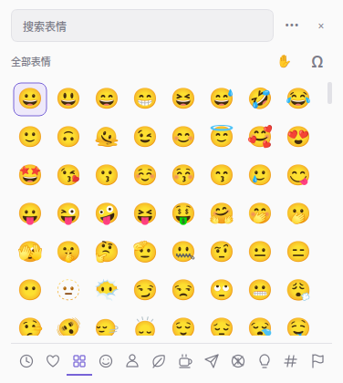
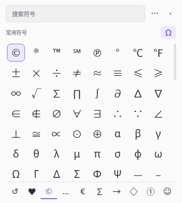

# kMoji

为 KDE Plasma 6 / Wayland 制作的表情与特殊符号面板。Qt 6 界面，通过 Fcitx5 直接提交文字，
不模拟按键、不改写剪贴板。界面与输入法插件分别运行。

紧凑布局参考 Windows 表情面板与 [Smile](https://github.com/mijorus/smile)：搜索框、
表情网格、底部图标分类栏。标题栏的 `Ω` 按钮在表情和特殊符号之间切换；肤色和更多选项
按需展开，多选组合栏仅在选中后出现。



## 功能

- Unicode 17.0：1,914 个基础 emoji，附带支持的肤色变体。
- 1,600+ 个特殊符号：标点、货币、数学、箭头、几何、字母与数字等 8 个分类。
- 符号以纯文本插入，不附加 emoji 变体选择符；适合公式、文档和代码注释。
- 九个表情分类与八个符号分类，均可浏览、收藏和查看最近使用。
- 中文、英文、无声调拼音搜索；支持粘贴关键词，符号还可按 `U+` 编码检索。
- 六种肤色选择、多个 emoji 组合、连续输入。
- 跟随系统 / 浅色 / 深色外观。
- 界面文案随系统语言切换，内置英文源字符串和中文翻译。
- 鼠标悬停约半秒显示表情或符号的中英文名称，移开或滚动时自动隐藏。
- 收藏、最近使用、肤色和外观保存在 `~/.config/kmoji/kmoji.conf`。
- 焦点切换后取消输入会话；密码和敏感输入框不触发面板。

标题栏 `Ω` 或 `Ctrl + Shift + S` 打开特殊符号目录：



## 使用

| 操作 | 功能 |
| --- | --- |
| `Win + .` / `Ctrl + Alt + .` | 在文本框中打开面板 |
| `Ctrl + Shift + S` / 标题栏 `Ω` | 切换表情与特殊符号 |
| 输入文字 | 搜索；中文输入法状态下可直接键入拼音，例如 `xiongmao` |
| `Ctrl + V` | 粘贴搜索文字 |
| 方向键 / `PageUp` / `PageDown` | 浏览表情或符号 |
| `Tab` / `Shift + Tab` | 在当前面板内切换分类 |
| 点击 / `Enter` | 输入当前项；已有组合时，Enter 输入组合 |
| `Shift + 点击` / `Shift + Enter` | 将当前项加入组合；再按 Enter 或点“输入”提交 |
| 右键 / `Ctrl + D` | 收藏 / 取消收藏 |
| 右上角 `···` | 展开连续输入与外观选项 |
| 连续输入 | 提交后保留面板 |
| `Esc` | 取消并关闭 |
| 更多选项中的“外观” | 依次切换浅色、深色、跟随系统 |
| 分类标题旁的手掌图标 | 展开肤色选择 |

搜索默认在当前分类内进行。需要搜索全部 emoji 时选择“全部表情”。
符号面板的搜索会跨全部分类，可输入中文名称、英文名称、拼音或编码，例如
“箭头”“arrow”“jiantou”“2192”。最近使用的记录保存基础 emoji，展示与插入时
使用当前选择的肤色；符号按原样插入，不参与肤色变体。符号面板同样记录最近使用，
并支持右键收藏。

## 构建与预览

依赖：C++20、CMake、Ninja、Fcitx5 开发文件、Qt 6 Widgets/Network、Qt LinguistTools、gettext、彩色 emoji 字体。
Arch 的包为 `base-devel cmake ninja fcitx5 qt6-base qt6-tools gettext qt6-wayland noto-fonts-emoji`。

```sh
cmake -S . -B build -G Ninja \
  -DCMAKE_BUILD_TYPE=RelWithDebInfo \
  -DCMAKE_INSTALL_PREFIX="$HOME/.local" -DCMAKE_INSTALL_LIBDIR=lib
cmake --build build -j4
./build/kmoji --preview
# 直接预览特殊符号
./build/kmoji --preview --symbols
```

源码附带离线数据（`data/emoji.json` 与 `data/symbols.json`），无须在构建或使用时访问网络。
需要更新符号目录时运行 `python scripts/generate-symbols.py`；它只读取本机 Unicode
字符数据，若安装了 ICU `uconv` 会同时生成拼音索引。

## 安装与启用

### Arch Linux 系统安装

在 [Releases](https://github.com/wanoful/kmoji/releases) 下载 `.pkg.tar.zst` 包后：

```sh
sudo pacman -U ./kmoji-*.pkg.tar.zst
# 在 KDE 桌面中以普通用户运行，添加窗口规则、释放快捷键并重启 Fcitx5
kmoji-setup
```

启用命令会先备份用户配置，不要使用 sudo 运行。系统包本身不会修改用户配置。
已通过下方脚本安装用户版时，`~/.local` 中的旧插件会优先于系统版加载；请先使用
相应安装备份恢复用户版，再安装系统包。AUR 维护步骤见 [发布说明](docs/publishing.md)。

### 从源码安装到用户目录

安装脚本额外需要 Python、PyGObject、`busctl` 和 KDE 的 `qdbus6`。只安装到当前用户的
`~/.local`，不需要 sudo。安装前备份文件到 `~/.local/state/kmoji/backup-*`。

```sh
# 仅安装，保留当前输入法与快捷键
python scripts/install.py

# 安装、添加 KWin 窗口规则、停用旧的 I'm Emoji Picker，并重启 Fcitx5
python scripts/install.py --activate
```

Fcitx5 设置 → 附加组件 → kMoji 可以修改呼出快捷键。
KWin 规则使面板不获取焦点，并显示在 Popup 层；原文本框继续持有输入法会话。
桌面会话中若绑定了别的应用的相同快捷键，需要解除冲突。

回退至某次安装前的版本与设置：

```sh
python scripts/restore.py ~/.local/state/kmoji/backup-YYYYMMDD-HHMMSS
```

恢复会还原该备份内的 Fcitx5 / KWin 配置；请注意备份之后的手动配置也会被还原。

## 验证

```sh
python tests/integration.py
```

测试启动私有 D-Bus 和 Fcitx5，使用离屏 Qt 界面，不操作当前桌面输入法。
覆盖直接提交、ZWJ / 肤色序列、连续输入、失焦与销毁后拒绝提交、敏感输入框、
过期会话、英文 / 中文 / 拼音搜索、分类浏览、多表情组合、收藏与历史持久化，
符号目录、符号模式和 `U+` 编码搜索，以及中文翻译加载和英文回退。

安装后，在桌面终端运行真实 Qt 文本框测试（额外需要 Qt Gui 私有开发头文件）：

```sh
cmake -S . -B build -DKMOJI_BUILD_DESKTOP_SMOKE=ON
cmake --build build -j4
QT_IM_MODULE=fcitx ./build/kmoji-desktop-smoke
```

这会短暂打开一个测试文本框，经 Qt 的输入法接口发送测试按键，验证面板冷启动、
搜索和直接提交，并保留文本框原有内容。它不会向其他应用模拟全局键盘输入。

导出界面预览：

```sh
QT_QPA_PLATFORM=offscreen ./build/kmoji --screenshot /tmp/kmoji.png
```

## 翻译

界面源字符串为英文。Qt 界面的中文翻译保存在 `translations/kmoji_zh_CN.ts`，构建时
由 Qt LinguistTools 的 `lrelease` 编译为 `.qm` 并嵌入 `kmoji` 可执行文件，运行时按
系统语言自动加载；没有对应翻译时回退到英文，不需要安装额外的运行时文件。

Fcitx5 附加组件的配置项使用 gettext，中文翻译在 `po/zh_CN.po`，构建时由 `msgfmt`
编译并安装到 `share/locale`。附加组件的显示名称和说明则由 `data/kmoji.conf` 的
`Name[zh_CN]` / `Comment` 提供。

修改界面文案后重新提取字符串：

```sh
cmake --build build --target update_translations
# 或直接运行
/usr/lib/qt6/bin/lupdate src -ts translations/kmoji_zh_CN.ts -no-obsolete
```

用 Qt Linguist 或任意文本编辑器补全翻译，再正常构建即可。新增界面语言时新建
`translations/kmoji_XX.ts`，并把它加入 `CMakeLists.txt` 的 `TS_FILES`；新增附加组件
语言时在 `po/` 下添加对应 `.po` 并安装到相应 locale 目录。
构建依赖 `qt6-tools`（提供 `lupdate` / `lrelease`）和 `gettext`（提供 `msgfmt`），
运行时不依赖它们。

## 结构与边界

- `src/addon.cpp`：Fcitx5 原生模块，在输入法事件循环中处理键盘和 `commitString()`。
  使用弱引用和会话编号校验输入目标。进程间通信通过权限 0600 的 Unix socket，
  并校验对端用户 ID；断开、超时或失焦后放弃会话。
- `src/picker.cpp`：独立 Qt 6 界面，负责检索、绘制与偏好设置。列表使用委托绘制，
  不为每个条目创建控件。首次触发时启动，后续触发复用进程。被插件启动时不创建
  自己的 Qt 输入法上下文，避免干扰目标应用。
- `scripts/generate-data.py`：从 Unicode 17 / CLDR 48 生成分类、中文标签与肤色映射，
  利用 ICU `uconv` 生成拼音索引。仅重新生成数据时需要联网和 `uconv`。
- `scripts/generate-symbols.py`：从本机 `unicodedata` 和固定的 Unicode 区块生成
  `data/symbols.json`，补充中文名、英文名、拼音与编码索引；不联网。
- `data/symbols.json`：特殊符号目录，与 emoji 共用提交、收藏和搜索逻辑。
- `translations/`：Qt 翻译源文件；`.ts` 提交到仓库，`.qm` 在构建时生成并嵌入。
- `po/`：Fcitx5 附加组件的 gettext 翻译源文件。

首版面向 KDE Plasma 6 / Wayland，其他桌面未验证。目标应用需正确接入 Fcitx5。
面板打开时键盘用于搜索和选择，拼音不会转换成汉字；可以直接用拼音、英文或粘贴中文搜索。
当前没有颜文字、自定义标签、混合肤色编辑，以及光标旁定位；面板由 KWin 居中显示。
特殊符号覆盖 Unicode 中常用的标点、符号与数字区块，不包含全部非常用区块。
emoji 能否显示取决于系统彩色 emoji 字体，特殊符号则取决于系统正文字体的字符覆盖。

代码为 MIT 许可；Unicode / CLDR 数据使用 [Unicode 数据许可](data/UNICODE-LICENSE.txt)。
